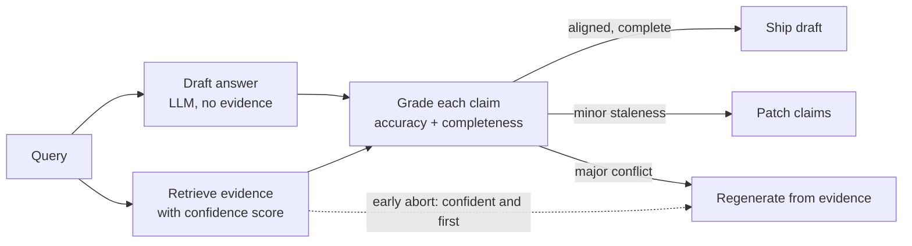

# PSV-RAG

**Optimistic Retrieval-Augmented Generation with Parallel Speculative Drafting and Verification**

> Status: early concept and reference design. Implementation and benchmarks in progress.
> Author: Chidiebere (Chidi) Okoene · First published: November 2026

## The idea

Standard RAG is a queue: the model cannot write a token until retrieval returns. PSV-RAG removes the queue.

1. **Parallel speculative draft.** When a query arrives, the LLM starts drafting from its own knowledge while the retriever searches the source and returns evidence with a calibrated confidence score.
2. **Verify.** A grader checks each claim in the draft against the evidence on two axes: accuracy (contradicted or stale?) and completeness (did the evidence hold something critical the draft missed?).
3. **Route by severity.** An aligned draft ships unchanged. A stale date or figure gets a targeted patch. A wrong core premise means the draft is discarded and regenerated from the evidence.

If confident evidence arrives before the draft finishes, the draft is aborted early and generation switches to grounded mode.



## When it pays off

With retrieval time R, generation time G, grading time V, rework rate p and fix time F:

```
T_RAG = R + G
T_PSV = max(R, G) + V + p·F
Saving = min(R, G) − V − p·F
```

The maximum saving is the retrieval time, and grading costs something on every request. PSV-RAG wins when retrieval is slow (federated sources, multi-hop search, reranking, external APIs), most drafts pass, and grading is cheap.

## Routing policy

| Retrieval confidence | Grader verdict | Action |
| --- | --- | --- |
| High, arrives before draft ends | Not yet graded | Abort draft, generate grounded |
| Any | Aligned and complete | Ship draft |
| High | Minor staleness | Surgical patch |
| High | Missing critical caveat | Add the missing content |
| High | Core premise contradicted | Discard and regenerate |
| Any | Claim unsupported by the evidence | Targeted retrieval; drop or hedge if nothing turns up |
| High, but sources disagree | Conflicting evidence | Rank by recency and authority; state the disagreement |
| Any | Patched answer fails its re-check | Discard and regenerate |
| Low | Contradicts draft | Hedge, show both, or flag for review |
| Low or none | No relevant evidence | Ship draft, marked unsourced |
| Gated domain | — | Skip the draft, generate grounded |
| System under load | — | Skip the draft, run sequential RAG |

## How it differs from related work

- **Speculative RAG** (Wang et al., 2024): a small model drafts *from* retrieved documents and a larger model verifies. PSV-RAG drafts *without* evidence, concurrently with retrieval.
- **CRAG** (Yan et al., 2024): routes on retrieval confidence. PSV-RAG uses that signal to decide how far to trust the draft.
- **RARR** (Gao et al., 2022): post-hoc research and revision. PSV-RAG runs retrieval in parallel rather than after generation.
- **PipeRAG / RaLMSpec** (2024): speculate on retrieval at the systems level. PSV-RAG speculates on the answer.

## Roadmap

- [ ] Reference implementation (async draft + retrieval, claim-level grader, severity router)
- [ ] Early-abort controller
- [ ] Benchmarks against a sequential RAG baseline: latency (p50/p95), pass rate, rewrite rate, factual precision
- [ ] Write-up / preprint

## Citation

If you use or build on PSV-RAG, please cite:

```bibtex
@misc{okoene2026psvrag,
  author = {Okoene, Chidiebere},
  title  = {PSV-RAG: Optimistic Retrieval-Augmented Generation with Parallel Speculative Drafting and Verification},
  year   = {2026},
  month  = {nov},
  howpublished = {\url{https://github.com/ChidiOkoene/psv-rag}}
}
```

## License

Apache License 2.0. See [LICENSE](LICENSE).

## References

- Kung & Robinson (1981). On Optimistic Methods for Concurrency Control. ACM TODS 6(2).
- Yan et al. (2024). Corrective Retrieval Augmented Generation. arXiv:2401.15884.
- Gao et al. (2022). RARR. arXiv:2210.08726.
- Wang et al. (2024). Speculative RAG. arXiv:2407.08223.
- Jiang et al. (2024). PipeRAG. arXiv:2403.05676.
- Zhang et al. (2024). RaLMSpec. arXiv:2401.14021.
- Min et al. (2023). FActScore. arXiv:2305.14251.
